# 🧠 Strategic Copilot
### Causal Decision Intelligence Platform | From Correlation to Causation to Strategic Decisions

<p align="center">
  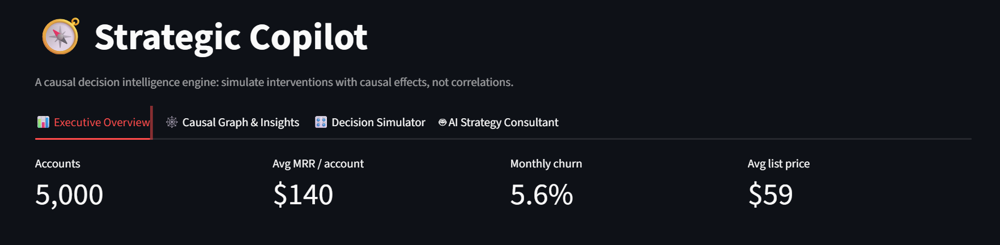
</p>

<p align="center">
  <strong>From correlation → causal inference → decision simulation → strategic recommendations</strong>
</p>

<p align="center">
  An AI-assisted decision intelligence platform combining causal inference, Double Machine Learning, Monte Carlo simulation, and LLM-powered executive analysis to evaluate hypothetical business interventions.
</p>

<p align="center">
  
  
  
  
  
  
</p>

---

# 1. Overview

**Strategic Copilot** is an end-to-end Causal Decision Intelligence platform designed to explore how hypothetical business interventions may influence financial performance and customer retention.

Traditional business intelligence systems primarily describe historical performance through KPIs, trends, and correlations.

Predictive models estimate what might happen based on historical patterns.

But business decision-makers often need to answer a different question:

> What could happen if we change a business decision?

Consider a SaaS company evaluating whether to increase its monthly advertising budget by 20%.

A traditional analytics dashboard might show that companies spending more on advertising tend to generate more revenue.

However, this relationship may be influenced by factors such as company size, customer engagement, and seasonality.

Strategic Copilot attempts to go beyond this observational relationship by combining:

- Exploratory and observational analytics
- Explicit causal graph specification
- DoWhy causal identification and refutation
- EconML Double Machine Learning
- Monte Carlo decision simulation
- Probabilistic financial and churn risk analysis
- LLM-powered executive recommendations

The platform connects these capabilities into a single analytical workflow:

**Data → Observation → Causal Estimation → Intervention → Simulation → Strategic Decision**

# 2. The Problem It Addresses

Different analytical approaches answer different business questions.

| Analytical approach | Primary question |
|---|---|
| Descriptive Analytics | What happened? |
| Diagnostic Analytics | Why did it happen? |
| Predictive Analytics | What might happen? |
| Causal Inference | What is the effect of an intervention? |
| Decision Intelligence | Which decision should we evaluate, and what risks accompany it? |

Strategic Copilot explores the connection between causal inference and decision intelligence.

### Example business scenario

A SaaS company wants to increase advertising expenditure.

Instead of directly assuming that higher advertising spend will increase revenue, the platform follows this workflow:

1. Explore historical advertising and revenue relationships.
2. Identify potential confounders.
3. Specify an assumed causal Directed Acyclic Graph (DAG).
4. Estimate treatment effects using causal inference techniques.
5. Compare naive observational estimates with adjusted estimates.
6. Simulate hypothetical interventions.
7. Evaluate expected financial impact and uncertainty.
8. Generate an executive-oriented decision memo using an LLM.

The objective is to make the assumptions, analytical evidence, and potential risks more visible before evaluating a business decision.

# 3. System Architecture

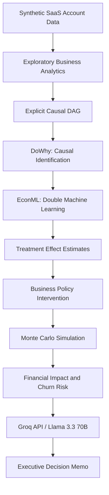

The application consists of four connected analytical layers:

1. Business Analytics
2. Causal Inference
3. Decision Simulation
4. AI Strategy Consultant

# 4. Key Capabilities

| Module | Functionality |
|---|---|
| Exploratory Analytics | SaaS revenue, MRR, churn, advertising spend, and customer segments |
| Causal Modeling | Explicit DAG specification and observed confounder adjustment |
| Causal Estimation | DoWhy identification and EconML Double Machine Learning |
| Causal Diagnostics | Confidence intervals, ground-truth comparisons, and placebo refutation |
| Decision Simulation | Interactive pricing and advertising interventions |
| Monte Carlo Analysis | Distribution of possible financial and churn outcomes |
| Risk Analysis | Expected, downside, and upside scenarios |
| AI Strategy Consultant | LLM-generated executive recommendations and decision memos |
| Interactive Interface | Streamlit dashboard with analytical and simulation controls |

# 5. Product Walkthrough

## 5.1 Executive Overview & Exploratory Analytics

The first stage establishes the observational baseline before performing causal analysis.

It provides:

- Total customer accounts
- Average Monthly Recurring Revenue (MRR)
- Monthly churn rate
- Average subscription list price
- Historical MRR trends
- Historical churn trends
- Interactive variable exploration
- Observational relationships
- Correlation analysis

### Executive KPI Dashboard

<p align="center">
  
</p>

### MRR & Churn Trends

<p align="center">
  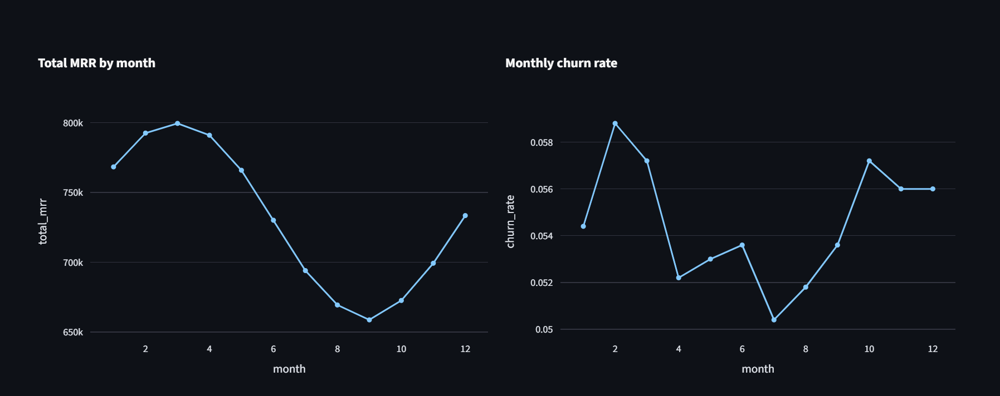
</p>

Historical trends establish the business baseline and provide visibility into changes in revenue and customer retention.

### Interactive Data Explorer

<p align="center">
  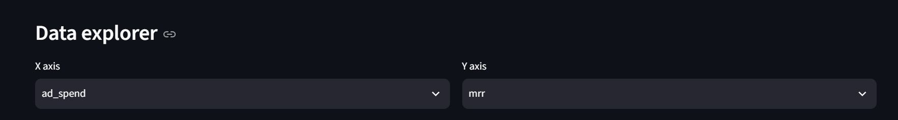
</p>

Users can dynamically explore selected variables and investigate relationships across the customer portfolio.

### Observational Relationships

<p align="center">
  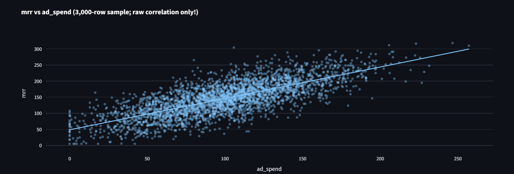
</p>

The scatter plot illustrates the initial observational relationship between advertising expenditure and MRR.

However, an observed relationship does not automatically establish a causal effect.

### Correlation & Potential Confounding

<p align="center">
  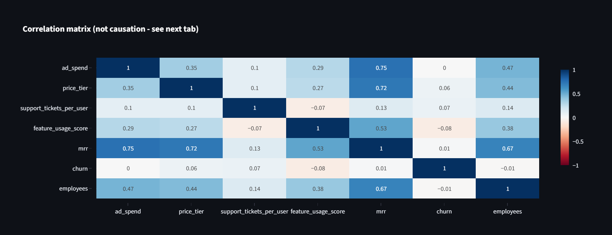
</p>

The correlation matrix helps investigate relationships between business variables.

For example, company size may influence both advertising expenditure and revenue, potentially introducing confounding bias into a naive regression.

This motivates the causal inference stage.

## 5.2 Causal Inference & Effect Estimation

The second stage moves from observational relationships to explicitly modeled causal relationships.

Strategic Copilot specifies relationships between:

- Treatment variables
- Outcome variables
- Observed confounders
- Potential intervention pathways

### Directed Acyclic Graph

<p align="center">
  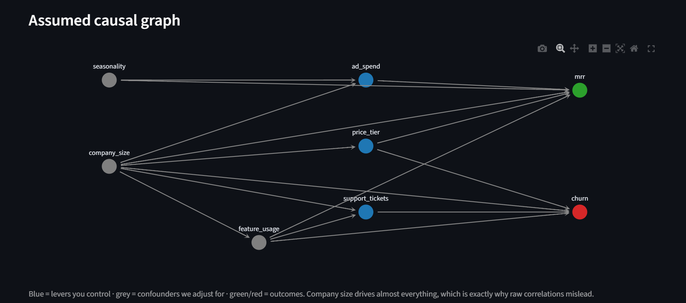
</p>

The DAG represents the assumed causal structure of the business problem.

Making these assumptions explicit helps identify which observed variables should be considered when estimating treatment effects.

**Important:** The graph is specified using assumed causal relationships. It is not automatically discovered from the data.

### Naive vs. Causal Effect Comparison

<p align="center">
  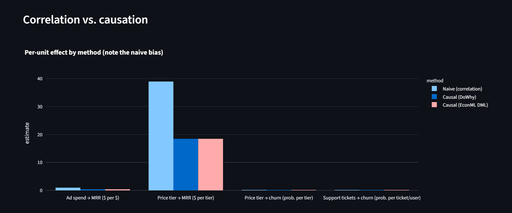
</p>

The application compares three estimation approaches:

**1. Naive Observational Regression**

Provides a baseline estimate without the specified causal adjustment.

**2. DoWhy**

Uses the specified causal graph to identify and estimate effects through the backdoor adjustment approach.

**3. EconML Double Machine Learning**

Uses residualization and machine learning nuisance models to estimate treatment effects while adjusting for observed confounders.

This comparison helps investigate how estimates change after accounting for observed confounding.

### Causal Diagnostics

<p align="center">
  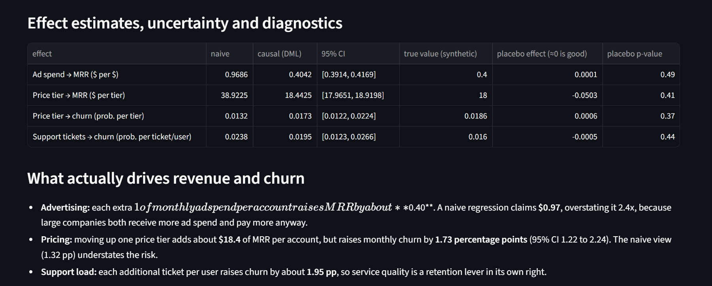
</p>

The diagnostics layer reports:

- Estimated treatment effects
- Confidence intervals
- Synthetic ground-truth comparisons
- Placebo treatment refutation results

The synthetic ground truth provides a benchmark for evaluating whether the estimation procedure recovers the effects used to generate the dataset.

Placebo refutation provides an additional diagnostic, rather than definitive proof of causal validity.

### Treatment and Outcome Relationships

The application investigates the following relationships:

| Treatment | Outcome |
|---|---|
| Advertising Spend | MRR |
| Subscription Price Tier | MRR |
| Subscription Price Tier | Customer Churn |
| Support Tickets per User | Customer Churn |

## 5.3 Decision Intelligence & Monte Carlo Simulation

After estimating treatment effects, the platform converts the analysis into a hypothetical business intervention.

Instead of asking:

"What was the historical relationship?"

The application explores:

"What could happen if we change the business policy?"

### Policy Intervention Controls

<p align="center">
  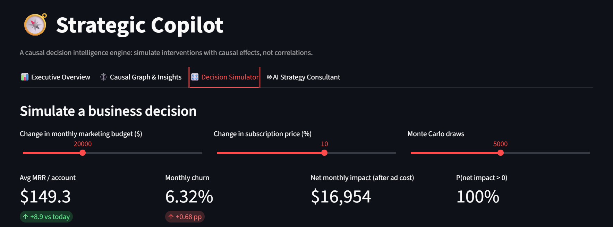
</p>

Users can modify:

- Monthly advertising expenditure
- Subscription pricing
- Simulation draw count
- Intervention parameters

The simulation supports different draw counts, including 1,000, 5,000, and 20,000.

### Monte Carlo Outcome Distributions

<p align="center">
  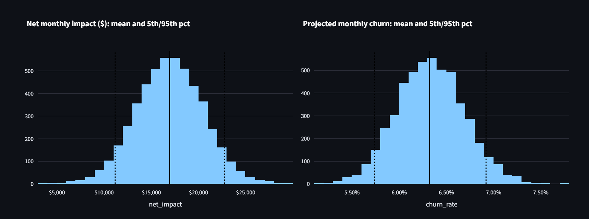
</p>

Instead of producing a single deterministic output, the simulator generates distributions of possible outcomes under the selected assumptions.

Two major areas of analysis are:

**Financial Impact**

- Expected MRR
- Retained MRR
- Change in retained MRR
- Net monthly financial impact after advertising costs
- Probability of positive net impact

**Customer Retention**

- Projected monthly churn
- Churn outcome distribution
- Potential downside and upside scenarios

The simulation incorporates uncertainty in estimated treatment effects and binomial variation in churn outcomes.

### Risk & Percentile Analysis

<p align="center">
  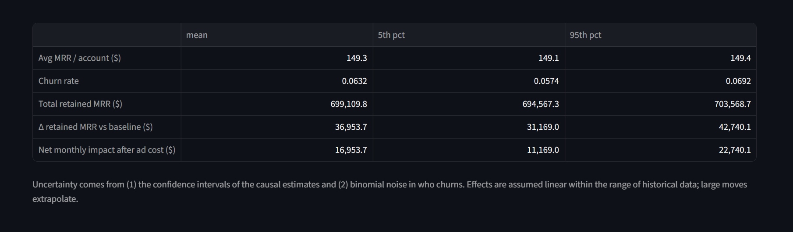
</p>

The simulator summarizes outcomes using:

| Measure | Interpretation |
|---|---|
| Mean | Average simulated outcome |
| 5th Percentile | Lower-tail outcome |
| 95th Percentile | Upper-tail outcome |

This allows decision-makers to examine expected outcomes alongside uncertainty and potential downside risk.

## 5.4 AI Strategy Consultant

The final layer converts quantitative analytical outputs into an executive-friendly narrative.

<p align="center">
  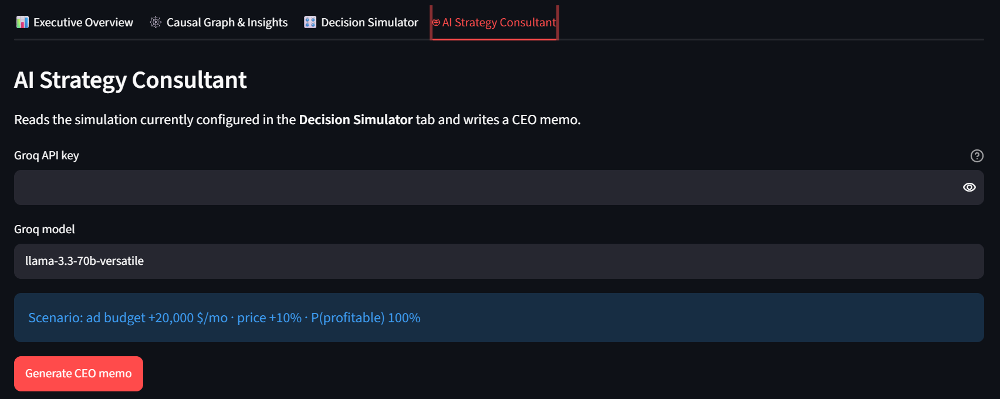
</p>

### Technology

**Groq API + Llama 3.3 70B**

The AI Strategy Consultant receives analytical information such as:

- Selected business intervention
- Baseline business metrics
- Estimated causal effects
- Confidence intervals
- Monte Carlo simulation summaries
- Financial impact distributions
- Probability of positive net impact

It generates a structured executive memo covering:

- Strategic recommendation
- Expected financial impact
- Potential business risks
- Uncertainty and assumptions
- Strategic implications
- Recommended next steps

### Separation of Analytical Computation and AI Reasoning

One important design decision was to separate numerical computation from LLM-generated recommendations.

The quantitative engine produces the causal estimates and simulation results.

The LLM interprets those outputs and communicates them in business-oriented language.

This avoids treating the LLM as the source of numerical or causal truth.

An offline template-based memo fallback is also available when live API access is unavailable.

# 6. Dataset & Experimental Design

The project uses a programmatically generated synthetic SaaS dataset.

The data generator creates customer-account observations over a 12-month period using predefined relationships between business variables.

| Dataset Property | Value |
|---|---|
| Customer Accounts | 5,000 |
| Observation Period | 12 months |
| Total Observations | 60,000 account-month records |
| Data Type | Synthetic panel data |
| Random Seed | 42 |
| Generated Dataset | `saas_historical_data.csv` |

### Why Synthetic Data?

The synthetic data generator defines the underlying structural relationships and treatment effects.

This provides a known ground-truth benchmark for evaluating the causal estimation workflow.

It helps investigate:

- How naive estimates differ from adjusted estimates
- Whether estimated effects recover the underlying data-generating relationships
- How observed confounding affects estimates
- Whether placebo refutation produces approximately null effects

The causal estimation module uses a sample of up to 12,000 observations for model estimation.

**Dataset disclaimer:** The dataset is synthetic and does not represent real customers, company records, or actual business performance.

# 7. Mathematical Framework

## 7.1 Double Machine Learning

Traditional regression can suffer from omitted-variable bias when observed confounders influence both the treatment and outcome.

Strategic Copilot uses the residualization framework behind Double Machine Learning.

Conceptually:

\[
Y-\mathbb{E}[Y|X]
=
\theta(T-\mathbb{E}[T|X])+\epsilon
\]

Where:

- \(Y\) = Outcome variable
- \(T\) = Treatment variable
- \(X\) = Observed confounders
- \(\theta\) = Estimated treatment effect
- \(\epsilon\) = Residual error

The nuisance models estimate:

\[
\mathbb{E}[Y|X]
\]

and

\[
\mathbb{E}[T|X]
\]

The residualized treatment and outcome are then used to estimate the treatment effect.

The implementation combines DoWhy with EconML LinearDML and machine learning nuisance models.

## 7.2 Monte Carlo Decision Simulation

The simulator evaluates hypothetical interventions by generating repeated draws from modeled uncertainty.

Conceptually:

\[
\theta^{(i)} \sim
\mathcal{N}(\hat{\theta},SE(\hat{\theta})^2)
\]

The simulated intervention outcomes are then used to construct distributions of financial impact and churn.

The results are summarized through:

- Expected financial impact
- Downside scenarios
- Upside scenarios
- Churn distributions
- Percentile-based risk boundaries

The simulation represents conditional scenario analysis rather than a guaranteed real-world forecast.

# 8. Technical Implementation

| Component | Implementation |
|---|---|
| Data Generation | Programmatic synthetic SaaS data |
| Exploratory Analysis | Pandas, NumPy and Plotly |
| Causal Graph | Explicitly specified DAG |
| Causal Identification | DoWhy |
| Causal Estimation | DoWhy backdoor estimation |
| Treatment Effect Estimation | EconML LinearDML |
| Nuisance Models | Scikit-learn Gradient Boosting |
| Refutation | DoWhy placebo treatment refutation |
| Decision Simulation | Monte Carlo sampling |
| Financial Analysis | MRR and retained revenue calculations |
| AI Integration | Groq API |
| Language Model | Llama 3.3 70B |
| User Interface | Streamlit |

# 9. Repository Structure

```text
strategic-copilot/
│
├── assets/
│   ├── 01_executive_overview.png
│   ├── 02_mrr_churn_trends.png
│   ├── 03_data_explorer_controls.png
│   ├── 04_naive_scatter.png
│   ├── 05_correlation_heatmap.png
│   ├── 06_causal_dag.png
│   ├── 07_effect_comparison_barchart.png
│   ├── 08_causal_diagnostics_table.png
│   ├── 09_decision_simulator_controls.png
│   ├── 10_monte_carlo_distributions.png
│   ├── 11_simulation_percentiles_table.png
│   └── 12_ai_consultant_interface.png
│
├── data/
│   └── saas_historical_data.csv
│
├── src/
│   ├── causal_model.py
│   ├── data_generator.py
│   └── simulator.py
│
├── .env.example
├── .gitignore
├── app.py
├── requirements.txt
└── README.md
```

The synthetic dataset is generated automatically when required by the application.

# 10. Installation & Quick Start

### Prerequisites

- Python 3.10+
- Git
- Groq API key (optional, required for live LLM-generated memos)

### Step 1: Clone the Repository

```bash
git clone https://github.com/Git-Saurav-Khyalia/strategic-copilot.git

cd strategic-copilot
```

### Step 2: Create a Virtual Environment

**Windows — PowerShell**

```powershell
python -m venv venv

.\venv\Scripts\Activate.ps1
```

**Windows — Command Prompt**

```cmd
python -m venv venv

venv\Scripts\activate.bat
```

**macOS / Linux**

```bash
python3 -m venv venv

source venv/bin/activate
```

### Step 3: Install Dependencies

```bash
python -m pip install --upgrade pip

pip install -r requirements.txt
```

### Step 4: Launch the Application

```bash
streamlit run app.py
```

The application will open in your browser.

On the first run, the application generates the synthetic dataset if it is not already available and executes the required analytical workflow.

# 11. AI Strategy Consultant Configuration

The AI Strategy Consultant supports Groq-hosted Llama models.

You can provide your API key through the application interface or configure it through environment variables.

Create a `.env` file in the project root using `.env.example` as a reference.

Example:

```env
GROQ_API_KEY=your_groq_api_key_here
GROQ_MODEL=llama-3.3-70b-versatile
```

Never commit API keys, credentials, or other secrets to GitHub.

If live API access is unavailable, the application can use its offline memo fallback.

# 12. Example Business Decision Workflow

Imagine a SaaS company considering an increase in advertising expenditure.

### Step 1 — Observe

Historical data shows a positive relationship between advertising spend and MRR.

However, this relationship may also be influenced by company size.

### Step 2 — Specify the Causal Structure

A DAG represents the assumed relationships between company size, advertising expenditure, and revenue.

### Step 3 — Estimate the Treatment Effect

DoWhy and EconML are used to estimate the treatment effect while adjusting for specified observed confounders.

### Step 4 — Simulate the Intervention

The decision-maker changes advertising expenditure and evaluates thousands of simulated outcomes.

### Step 5 — Evaluate Risk

The platform presents distributions of potential financial outcomes instead of relying on one deterministic estimate.

### Step 6 — Generate an Executive Recommendation

The AI Strategy Consultant converts the quantitative results into a structured memo describing:

- Expected impact
- Potential downside
- Uncertainty
- Key assumptions
- Strategic implications
- Recommended next steps

# 13. What Makes Strategic Copilot Different?

The main idea is not simply combining a dashboard with an LLM.

It is connecting different analytical approaches into one decision-support workflow.

| Layer | Contribution |
|---|---|
| Business Intelligence | Understand historical business performance |
| Causal Inference | Estimate intervention effects under stated assumptions |
| Decision Simulation | Evaluate potential outcomes and uncertainty |
| Generative AI | Communicate analytical findings as executive recommendations |

The project explores how business analytics, statistical reasoning, causal inference and Generative AI can work together.

# 14. Assumptions & Limitations

Strategic Copilot is an analytical prototype built using synthetic data.

Its results depend on the assumptions used to construct the dataset and analytical models.

### Causal Inference Limitations

- The causal DAG is manually specified using assumed relationships.
- Causal identification depends on the correctness of the specified graph.
- Double Machine Learning adjusts for specified observed confounders but cannot automatically eliminate unobserved confounding.
- Placebo refutation is a diagnostic, not proof of causal validity.
- Synthetic ground-truth comparisons do not establish real-world validity.

### Simulation Limitations

- Simulation outcomes are conditional on estimated treatment effects and model assumptions.
- The simulator propagates modeled uncertainty rather than all possible sources of business uncertainty.
- Effects are assumed linear within the model's specified intervention framework.
- Large interventions may involve extrapolation beyond the observed data.
- Simulated financial outcomes should not be interpreted as guaranteed forecasts.

### AI Limitations

- Generated recommendations depend on the quality and completeness of quantitative inputs.
- LLM-generated narratives may contain interpretation errors.
- Recommendations should be reviewed before being used in actual business decisions.
- The LLM does not independently establish causal relationships or calculate the underlying treatment effects.

# 15. Future Improvements

Potential extensions include:

- Treatment effect heterogeneity across customer segments
- Conditional Average Treatment Effect (CATE) estimation
- Sensitivity analysis for unobserved confounding
- Automated experiment and A/B test design
- Bayesian decision modeling
- Multi-treatment optimization
- Automated scenario comparison
- Decision history tracking
- SQL and data warehouse integration
- Real-time SaaS metrics integration
- Executive PDF report generation
- Authentication and role-based access
- Cloud deployment

# 16. Project Highlights

- End-to-end Causal Decision Intelligence workflow
- Interactive SaaS business analytics
- Explicit causal DAG specification
- DoWhy causal identification and refutation
- EconML Double Machine Learning
- Synthetic ground-truth benchmarking
- Interactive policy intervention simulator
- Monte Carlo-based financial and churn risk analysis
- LLM-powered executive decision memos
- Separation of quantitative computation and AI-generated narratives

# 17. Author

**Saurav Khyalia**

B.Tech — Electronics & Communication Engineering

Areas of Interest:
- Data Analytics & Business Intelligence
- Causal Inference & Decision Science
- Applied Machine Learning
- Generative AI
- AI-powered Business Applications

**GitHub:** https://github.com/Git-Saurav-Khyalia

---

If you find this project interesting, feel free to explore the repository and examine how business analytics, causal inference, probabilistic simulation and Generative AI can be connected into a single decision-support workflow.

**Repository:** https://github.com/Git-Saurav-Khyalia/strategic-copilot